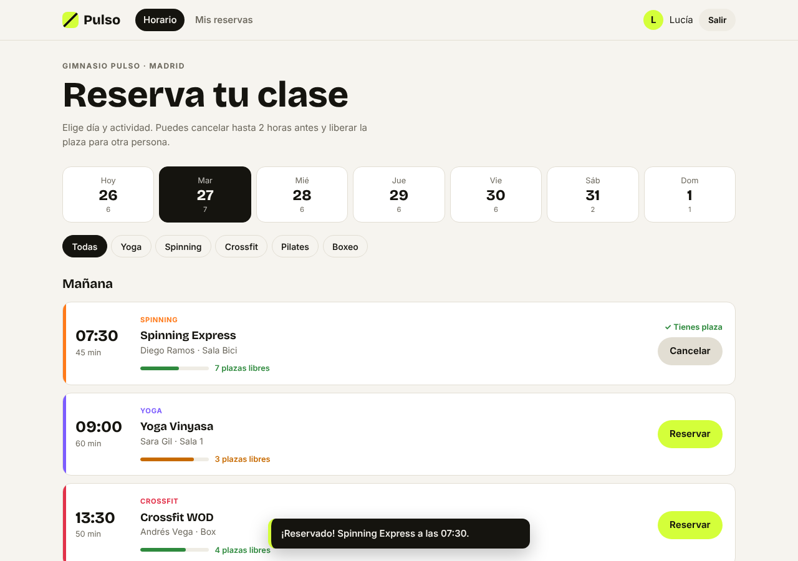
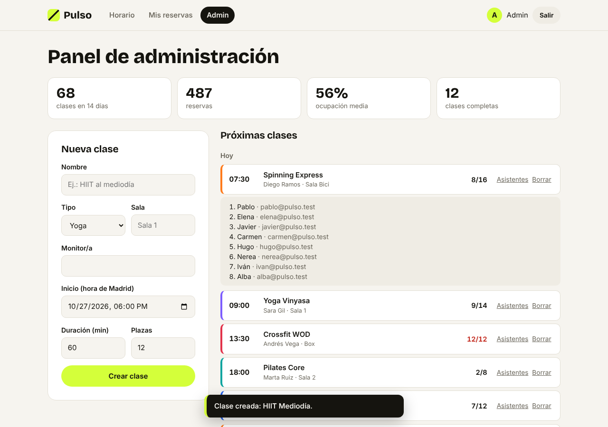
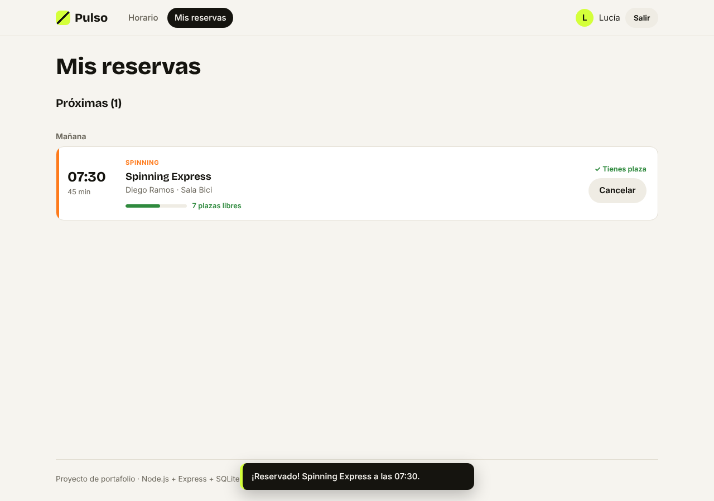

# Pulso · Reservas de clases de gimnasio (full-stack)

Aplicación completa para reservar clases de un gimnasio: **API REST en Node.js + Express con base de datos SQL** y **frontend en React + TypeScript**. Incluye registro e inicio de sesión con **JWT**, roles (socio y administrador) y reglas de negocio reales: aforo, solapamiento de horarios y límite para cancelar.



## Probarlo

Cuentas de prueba (también hay botones en la pantalla de login):

| Rol | Email | Contraseña |
| --- | --- | --- |
| Socia | `demo@pulso.test` | `demo1234` |
| Administrador | `admin@pulso.test` | `admin1234` |

## Funcionalidades

**Socios**
- Horario de los próximos 7 días, con filtro por actividad (yoga, spinning, crossfit, pilates, boxeo). El día y el filtro quedan en la URL.
- Reservar y cancelar con un clic, con barra de plazas libres (verde, naranja o roja según ocupación).
- "Mis reservas": próximas clases e historial.

**Administración**
- Crear clases (con validación de cada campo) y borrarlas con confirmación.
- Ver la lista de asistentes de cada clase.
- Resumen: clases, reservas, ocupación media y clases completas.

**Reglas que valida el servidor**
- No se puede reservar una clase que ya empezó, que está completa o que ya tienes.
- No se pueden tener dos clases que se solapen en horario.
- Solo se puede cancelar hasta **2 horas antes**.
- La reserva se hace dentro de una **transacción**, así dos personas no pueden quedarse a la vez con la última plaza.

| Panel de administración | Mis reservas | Móvil |
| --- | --- | --- |
|  |  |  |

## Arquitectura

```
reservas-fullstack/
├── server/                    API (Node.js + Express 5 + SQLite)
│   ├── src/
│   │   ├── schema.sql         Tablas, claves foráneas, índices y restricciones CHECK
│   │   ├── db.ts              Conexión y helper de transacciones
│   │   ├── app.ts             App de Express (también sirve el frontend compilado)
│   │   ├── routes.ts          Endpoints REST
│   │   ├── auth.ts            JWT y middlewares (requireAuth, requireAdmin)
│   │   ├── passwords.ts       Hash de contraseñas con scrypt
│   │   ├── schemas.ts         Validación de entradas con Zod
│   │   ├── errors.ts          Errores HTTP con un formato JSON único
│   │   ├── services/          Lógica de negocio y consultas SQL (clases, reservas, usuarios)
│   │   ├── time.ts            Conversión hora de Madrid ⇄ UTC (con horario de verano)
│   │   └── seed.ts            Cuentas de prueba y horario de ejemplo
│   └── test/                  Tests de la API con Vitest + Supertest
└── client/                    Frontend (React 19 + TypeScript + Vite)
    └── src/
        ├── api/               Cliente HTTP tipado y tipos compartidos
        ├── auth/              Sesión (token JWT + usuario actual)
        ├── lib/               Fechas, reglas de UI y hooks de React Query
        ├── components/        Tarjeta de clase, layout, avisos
        └── pages/             Horario, Mis reservas, Login/Registro, Admin
```

### API

| Método | Ruta | Acceso | Qué hace |
| --- | --- | --- | --- |
| POST | `/api/auth/register` | Público | Crea una cuenta y devuelve un token |
| POST | `/api/auth/login` | Público | Inicia sesión y devuelve un token |
| GET | `/api/me` | Usuario | Datos del usuario actual |
| GET | `/api/me/bookings` | Usuario | Sus reservas |
| GET | `/api/classes?from=&days=&type=` | Público | Horario (si hay sesión, indica cuáles tienes reservadas) |
| GET | `/api/classes/:id` | Público | Una clase |
| POST | `/api/classes/:id/booking` | Usuario | Reservar |
| DELETE | `/api/classes/:id/booking` | Usuario | Cancelar |
| POST | `/api/classes` | Admin | Crear clase |
| DELETE | `/api/classes/:id` | Admin | Borrar clase (y sus reservas) |
| GET | `/api/classes/:id/attendees` | Admin | Lista de asistentes |

Todos los errores tienen el mismo formato, con un código estable que el frontend usa para mostrar el mensaje:

```json
{ "error": { "code": "CLASS_FULL", "message": "La clase está completa." } }
```

### Decisiones técnicas

- **SQL a mano, sin ORM**, para que se vea la base de datos: `JOIN`, `LEFT JOIN` + `COUNT` para contar reservas en la misma consulta (sin N+1), `UNIQUE (user_id, class_id)`, claves foráneas con `ON DELETE CASCADE`, restricciones `CHECK` e índices. Se usa el módulo `node:sqlite` incluido en Node 22, sin dependencias nativas.
- **Consultas parametrizadas** en todas partes (nunca se concatena texto del usuario en el SQL), para evitar inyección SQL.
- **Contraseñas con scrypt y sal aleatoria**, comparadas con `timingSafeEqual`. El login responde lo mismo si el email no existe o la contraseña es incorrecta, para no revelar qué emails están registrados.
- **Validación con Zod** de cuerpo, query y parámetros; los errores por campo llegan al formulario.
- **La hora se inyecta** en la app (`now`), así los tests de "ya empezó" o "cancelar tarde" no dependen del reloj.
- **Fechas en UTC en la base de datos** y en hora de Madrid en la interfaz, con el cambio de horario de verano/invierno resuelto y testeado.
- **React Query** para los datos del servidor: caché por usuario, recarga tras reservar o cancelar y estados de carga/error. El día y el filtro viven en la URL.
- **Un solo despliegue**: en producción Express sirve la API en `/api` y el frontend compilado en el resto de rutas.

## Tests

**36 tests** en total:

- **API (22)**: registro y login, validación, rutas protegidas, permisos de admin, aforo, reservas duplicadas, clases empezadas, solapamientos (incluido que una clase que empieza justo al terminar otra sí se puede reservar), límite de cancelación, borrado en cascada, errores 404/400 y conversión de zonas horarias.
- **Frontend (14)**: formato de fechas en Madrid, qué botón mostrar en cada caso y el componente de tarjeta con Testing Library.

```bash
npm test
```

## Ejecutar en local

Requiere Node.js 22.18 o superior.

```bash
npm install
npm run dev        # API en http://localhost:3001 y web en http://localhost:5173
```

En producción:

```bash
npm run build      # compila el frontend
npm start          # Express sirve API + frontend en http://localhost:3001
```

Variables de entorno: `PORT`, `DATABASE_PATH` (por defecto `server/data/pulso.db`) y `JWT_SECRET` (obligatoria en producción).

### Despliegue

El archivo `render.yaml` permite desplegarlo en [Render](https://render.com) desde el panel: **New → Blueprint** y elegir este repositorio. En el plan gratuito la base de datos se reinicia con cada despliegue; al arrancar se vuelven a crear las cuentas y el horario de ejemplo.

## Tecnologías

**Backend:** Node.js 22 · Express 5 · SQLite (SQL) · JWT · Zod · TypeScript · Vitest · Supertest
**Frontend:** React 19 · TypeScript · Vite · React Router · TanStack Query · Testing Library · CSS propio (modo claro y oscuro)

---

Hecho por **Carlo Fabian Prado Ortiz** · [Portafolio](https://zitroolrac.github.io/Portfolio/) · [GitHub](https://github.com/ZitroOlrac)
